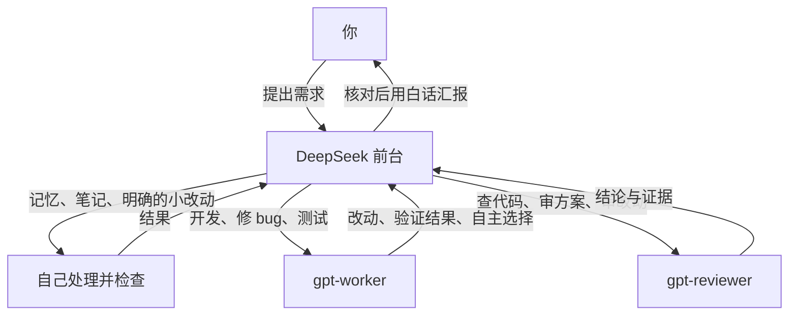

# pi-team

**一个前台，多位模型搭档。**

DeepSeek 负责与你交流、分派任务和核对结果，GPT 负责开发与审查。把现有的 `pi-desk` 工作流打包，让其他 Pi 用户可以安装和使用。

本仓库保留原版 `front-desk.md`、`gpt-worker.md`、`gpt-reviewer.md` 的提示词正文；只将 agent 的 `model:` 元数据改为安装时填写。没有改写分工、措辞或授权规则。

## 工作方式



- 小活由 DeepSeek 自己做，需要设计实现的工作交给 GPT。
- 定方案前先与 GPT 商量，最多两轮。
- 独立任务可并行派给多个 GPT；修改同一文件的任务顺序执行。
- 每个 GPT 都是新会话，需要前台重新交接完整背景。
- 分工由提示词引导，实际委派由 Pi 的 subagent 工具执行。

`pi-team` 是项目和启动命令名。第一版角色仍叫 `gpt-worker` 和 `gpt-reviewer`，保留原有提示词对这些名字的引用。

## 准备

支持 macOS、Linux；Windows 请在 WSL 中使用。

1. 安装 [Pi](https://pi.dev) **1.5.1+** 和 **Node.js 22.19+**。
2. 在 Pi 中配置 DeepSeek、GPT 的提供商与凭证，使用自己的账号。
3. 准备自己的 `~/.codex/AGENTS.md` 通用工作规则：原版 GPT 提示词会读取这个文件，前台启动时也会加载它（存在时）。仓库不包含作者个人的规则文件；没有规则时可以创建空文件。

```bash
pi --version
node --version
pi --list-models

# 仅在尚未存在时创建空规则文件，已有内容不会被覆盖
mkdir -p "$HOME/.codex"
touch "$HOME/.codex/AGENTS.md"
```

模型参数使用 Pi 接受的 `provider/model[:thinking]`，例如后缀 `:high`、`:xhigh`、`:max`。实际支持的等级由模型决定。请以自己 `pi --list-models` 的结果为准。

## 安装

```bash
git clone https://github.com/zhoupb01/pi-team.git
cd pi-team
bash install.sh \
  --frontdesk 'YOUR_PROVIDER/YOUR_DEEPSEEK_MODEL:max' \
  --worker 'YOUR_PROVIDER/YOUR_GPT_MODEL:high' \
  --reviewer 'YOUR_PROVIDER/YOUR_GPT_MODEL:xhigh'
```

**将占位符替换为自己的模型标识。** 省略 `--reviewer` 时沿用 `--worker` 的完整配置。

安装器会复制启动器、配置与角色文件。新环境会自动安装仓库随附的 Pi 官方 subagent 示例扩展，不需要额外下载依赖或运行 `npm install`。

已有 `~/.pi/agent/extensions/subagent/index.ts` 或 `index.js` 时保留原扩展。若 subagent 由其他包或路径提供，使用 `--skip-subagent`；需要兼容官方示例的 `agent/task/tasks/agentScope` 参数及 Markdown agent 格式。同一环境只启用一个提供 `subagent` 工具的扩展。

将命令目录加入 PATH（若尚未加入）：

```bash
export PATH="$HOME/.local/bin:$PATH"
```

可以把这行放入 `~/.zshrc` 或 `~/.bashrc`。进入项目目录运行：

```bash
pi-team --team-check
cd /path/to/your-project
pi-team
```

安装完成后可以移动或删除仓库副本。安装器不会改写普通 Pi 的默认模型、凭证、个人规则或现有 `pi-desk`；安装的 subagent 与角色在普通 Pi 中也可用。

## 试一次

先验证一个只读任务：

> 请用 gpt-reviewer 检查这个项目的 package.json，列出 scripts；然后你自己核对一次。不要修改文件。

查看工具输出，确认调用了 `gpt-reviewer` 和预期模型。再尝试开发任务：

> 修复这个 bug，让 gpt-worker 实现并验证，完成后交给 gpt-reviewer 检查 diff。

模型调用消耗你自己的账号额度。`--team-check` 只检查本地文件，不调用模型，也不验证凭证、模型服务或扩展启用状态。

## 文件位置

| 文件 | 用途 |
| --- | --- |
| `~/.local/bin/pi-team` | 启动器 |
| `~/.pi/agent/pi-team/config.json` | `frontdeskModel`：前台模型 |
| `~/.pi/agent/pi-team/front-desk.md` | 原版前台提示词 |
| `~/.pi/agent/agents/gpt-worker.md` | 原版开发提示词与模型配置 |
| `~/.pi/agent/agents/gpt-reviewer.md` | 原版审查提示词与模型配置 |
| `~/.pi/agent/extensions/subagent/` | 官方示例扩展，或用户已有的兼容版本 |

直接编辑已安装的配置即可，下次启动生效。两个 agent 的模型在各自 Markdown 顶部的 `model:` 中修改。

安装和启动都遵循 Pi 的 `PI_CODING_AGENT_DIR`。`PI_TEAM_BIN_DIR` 只影响安装时的命令位置：

```bash
PI_CODING_AGENT_DIR="$HOME/.pi-work/agent" \
PI_TEAM_BIN_DIR="$HOME/bin" \
bash install.sh --frontdesk 'provider/deepseek-model' --worker 'provider/gpt-model'

PI_CODING_AGENT_DIR="$HOME/.pi-work/agent" "$HOME/bin/pi-team"
```

自定义 agent 目录需要自己的模型和凭证配置。原版提示词仍读取 `~/.codex/AGENTS.md`，不随 agent 目录改变。

Pi 参数原样传递，例如 `pi-team --continue`、`pi-team --print '检查这个项目'`。查看启动器说明使用 `pi-team --team-help`。手动覆盖 `--tools` 时请包含 `subagent`。

## 更多搭档

名字 `pi-team` 为未来增加模型与角色留出了空间。当前发行版忠实保留 DeepSeek + GPT 的提示词，其中明确要求只使用两个 GPT agent。

要加第三位搭档，需要同时：

1. 在 `~/.pi/agent/agents/` 新建 agent 文件，填写独立的 `name`、`description`、`model`、`tools` 和角色提示词。
2. 修改**自己的** `front-desk.md`，调整“只用这两个 GPT agent”的限制，补充新角色的职责与调用时机。

仅添加文件不会自动改变前台的分工。更换前台模型时，也应调整个人提示词中对 DeepSeek 的描述。

## 更新与卸载

拉取新版本后，带自己的模型参数重新运行安装脚本。内容相同可重复安装；发现不同内容时，在写入前停止。明确要覆盖时加 `--force`，会先在原文件旁创建 `.bak-时间戳` 备份，再更新 pi-team 文件。

**已有同名 GPT agent 也适用此保护。** 从旧 `pi-desk` 迁移时请先查看差异；`--force` 会更新同名角色，旧 `pi-desk` 调用它们时也会使用更新后的版本。已有 subagent 扩展无论是否 `--force` 都不会被覆盖，升级扩展需要单独核对。

卸载默认位置的文件：

```bash
rm "$HOME/.local/bin/pi-team"
rm -r "$HOME/.pi/agent/pi-team"
```

如果 `gpt-worker.md`、`gpt-reviewer.md` 或 subagent 仍供旧 `pi-desk` 或其他工作流使用，请保留。仅当确定不再使用时才删除这些共享文件。备份文件和自定义目录按需处理。

## 运行边界

- **提示词不是沙箱。** DeepSeek 仍能改文件；GPT reviewer 没有 edit/write，但有 bash，因此不是强制只读隔离。
- **角色共享工作区。** 不同任务的上下文隔离，文件并不隔离；前台需要避免并发修改同一文件。
- **子进程使用自己的 Pi 配置。** 不会自动继承主会话所有 CLI 参数，例如临时 `-e` 扩展。提供商扩展应安装在子进程也能加载的位置。
- **原版工具清单也保留。** 两个 GPT agent 引用了 `codex_search`；这是额外的搜索工具，本仓库不提供它。需要网页搜索时请自行安装兼容工具，代码读写和 shell 工具由 Pi 提供。
- **原版提示词的规则保留。** 包括 GPT worker 不 commit、不 push，以及前台执行相应操作前询问用户等要求。
- **成本取决于实际调用。** 并行和审查会增加调用，子任务用量不一定计入主会话汇总。随附扩展最多每批 8 个任务、4 个同时运行。
- **提示词里的模型评价是原始工作流的表达。** 本仓库不保证某个模型永远更可靠，实际完成情况以证据为准。

## 开发与来源

```bash
node --test tests/*.test.mjs
bash -n install.sh
```

测试使用隔离目录和模拟 Pi，覆盖安装、冲突保护、备份、启动参数与退出状态，不需要 API Key。

subagent 来自 [earendil-works/pi v1.5.1](https://github.com/earendil-works/pi/tree/v1.5.1/packages/coding-agent/examples/extensions/subagent)，保持原样。版本、来源与哈希见 [UPSTREAM.md](vendor/subagent/UPSTREAM.md)。

本项目采用 [MIT](LICENSE) 许可证；上游代码的 [MIT 许可证](vendor/subagent/LICENSE) 单独保留。
