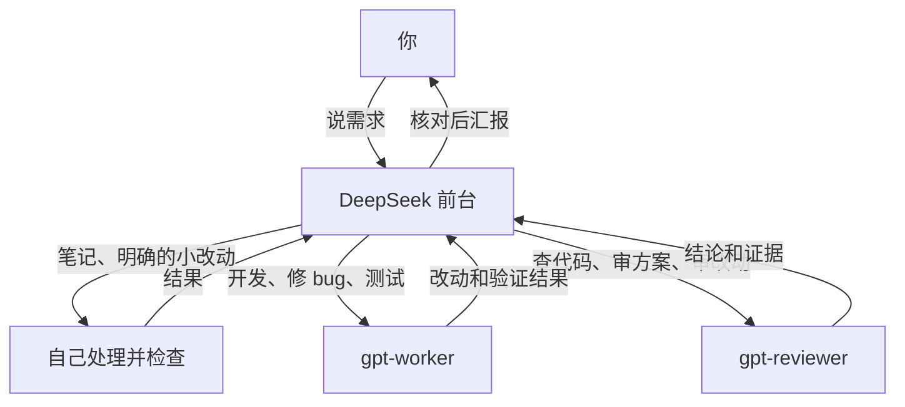

# 怎么用 pi-team

[回到 README](../README.md)

## 谁来做什么

你只跟前台说话。前台负责交接任务、核对结果，再用大白话告诉你。



- 前台自己记笔记、读文件、跑命令。怎么改已经说清楚的小改动，也由它做。
- 需要设计和实现的活，交给 `gpt-worker`。
- 查代码、审方案、审改动，交给 `gpt-reviewer`。
- 前台给你出方案前，会先找 GPT 商量。最多两轮；传话和一眼就清楚的小活除外。
- 每个 GPT 子任务都是新会话。前台要重新交代你的原话、目标、背景和文件路径。

这些分工靠提示词引导。实际派任务用的是 Pi 的 `subagent` 工具。
`pi-team` 是项目名和启动命令。两个角色保留 `gpt-worker`、`gpt-reviewer` 这两个名字，提示词里也用这两个名字。

## 给任务

第一次用，先按 [README](../README.md) 跑一次只读任务，确认角色和模型都对。
确认能调用后，你可以这样交开发任务：

> 修复这个 bug，让 gpt-worker 实现并验证，完成后交给 gpt-reviewer 检查 diff。

把 bug 的表现、怎么复现、你想要的结果一起告诉前台。它会把背景交给 GPT。

独立任务可以同时派。随附扩展每批最多 8 个任务，同时跑 4 个。
角色共享工作区，别同时改同一个文件。需要改同一文件时，让前台排队执行。
多人改完后，再让 reviewer 看一次合起来的 `git diff`。

reviewer 的工具里没有 `edit/write`，但有 `bash`。只读是提示词要求，不能当作沙箱。
子任务和审查都花你自己的模型额度，用量不一定计入主会话汇总。

## 常用命令

在你的项目目录运行：

```bash
pi-team
pi-team --continue
pi-team --print '检查这个项目，不要修改文件'
```

`--continue` 接着上次会话聊。`--print` 跑完这一条就退出。
这些 Pi 参数会原样传过去。它们不会改变角色的权限边界。

检查安装和查看启动器说明：

```bash
pi-team --team-check
pi-team --team-help
```

`--team-check` 只读本地配置和检查角色文件是否存在，不调用模型。
它不会验证凭证、模型服务，也不会检查 subagent 是否真的启用。

启动器默认把 `subagent` 加进工具清单。你手动传 `--tools` 时，也要带上它。例如：

```bash
pi-team --tools 'read,bash,subagent'
```

这个例子给前台保留 `read`、`bash` 和派任务的工具。`bash` 仍然能改文件。
子任务使用各自 agent 文件里的工具清单。

## 改模型和规则

直接编辑已安装的文件，下次启动生效：

| 你要改什么 | 默认位置 | 改哪里 |
| --- | --- | --- |
| 前台模型 | `~/.pi/agent/pi-team/config.json` | `frontdeskModel` |
| 开发模型 | `~/.pi/agent/agents/gpt-worker.md` | 文件顶部的 `model:` |
| 审查模型 | `~/.pi/agent/agents/gpt-reviewer.md` | 文件顶部的 `model:` |
| 前台分工 | `~/.pi/agent/pi-team/front-desk.md` | 你自己的提示词 |

模型标识用 `pi --list-models` 查。写成 `provider/model`，需要时加 `:high`、`:xhigh` 或 `:max`。
可用的思考等级由模型决定。

通用规则是可选的。你有规则，就放在 `~/.codex/AGENTS.md`。
启动器只在文件存在时把它交给前台；原版 GPT 提示词也会让角色去读这个路径。
仓库不附带作者的个人规则，你不用为了启动而建空文件。

你改过安装后的提示词，再运行安装器时会遇到内容冲突。处理方法见[更新与迁移](maintenance.md#更新)。

## 加第三位搭档

当前提示词明确要求前台只用两个 GPT 角色。你只加一个文件，前台不会自动换分工。

要加新角色，你需要做两件事：

1. 在 `~/.pi/agent/agents/` 新建 Markdown 文件，填写独立的 `name`、`description`、`model`、`tools` 和角色提示词。
2. 改你已安装的 `~/.pi/agent/pi-team/front-desk.md`。调整“只用这两个 GPT agent”的限制，写清新角色做什么、何时调用。

换前台模型时，也记得调整你自己的提示词里对 DeepSeek 的描述。

## 扩展和子任务

新环境会用仓库随附的官方 subagent 示例扩展。它装在 `~/.pi/agent/extensions/subagent/`。
已有扩展和其他路径的安装方式，见[安装与维护](maintenance.md#subagent-扩展)。

子任务会启动独立的 Pi 进程，使用自己的 Pi 配置。
主会话的 CLI 参数不会全部传给它，例如临时加的 `-e` 扩展。
如果模型依赖提供商扩展，要把扩展装在子进程也能加载的位置。

两个 GPT 角色的工具清单里有 `codex_search`，仓库不提供这个工具。
你要搜网页，就另装兼容工具，并让子进程也能加载。代码读写和 shell 工具由 Pi 提供。
